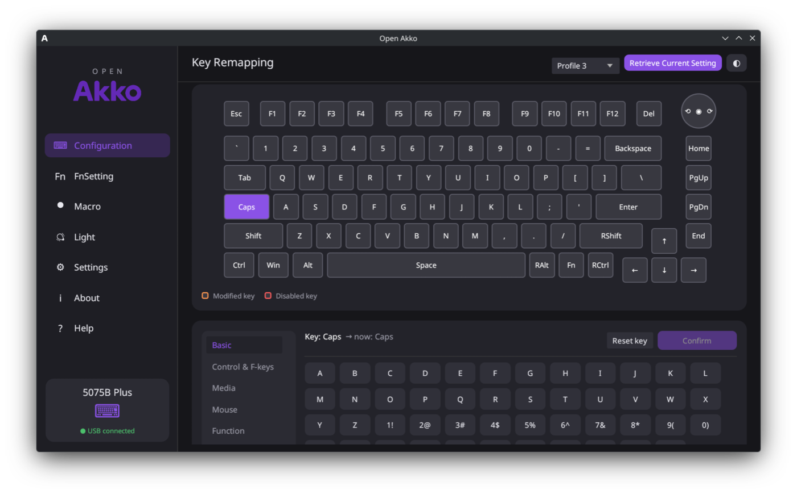
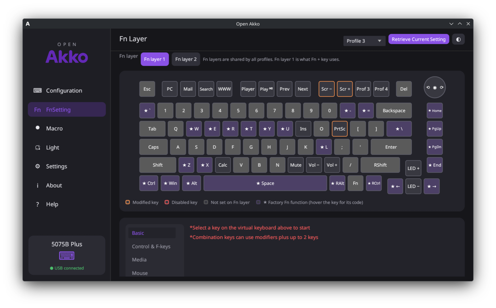
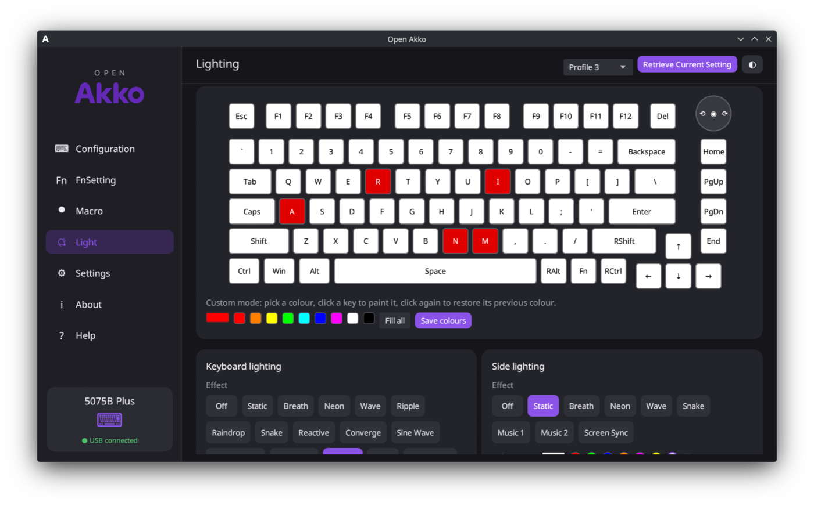
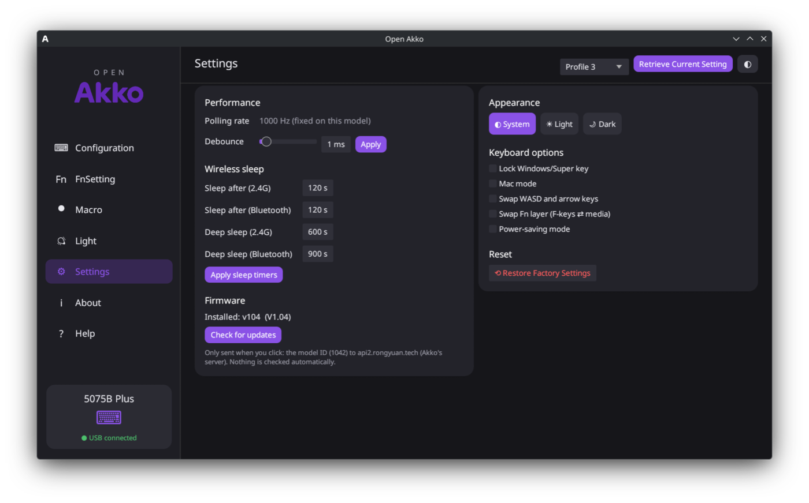

# Open Akko

Native, offline Linux configurator for Akko keyboards (YC3121 / YC500 family, e.g. the
5075B Plus). An unofficial replacement for **Akko Cloud Driver v4**, built by reverse
engineering the Windows app (v371.2.19). Pure Rust (egui): no Electron, no web engine,
no account, no telemetry.



> **Status:** early release (v0.2.0). Developed and hardware-tested on a **5075B Plus**
> only. Other models in the same family should work but are unverified. See
> [Known issues](#known-issues) and the [open issues](https://github.com/Yuxis445/Open-Akko/issues).

## Features

- **Connection:** USB cable or the 2.4 GHz receiver (battery level shown). Hotplug and
  wireless-sleep aware.
- **Configuration:** remap any key or knob part (keys, combos, media, mouse, functions,
  macros, disable) on the real keyboard drawing of your model.
- **FnSetting:** both Fn layers (shared by all profiles), with Akko's factory Fn functions marked ★.
- **Macro:** a local macro library. Recording reads the keyboard itself, so every key works,
  including Win, with real timing. Macros go into a free slot (of 50) on assignment.
- **Light:** every main and side effect, colour or rainbow, brightness, speed, direction,
  and per-key Custom painting.
- **Settings:** profiles, debounce, polling rate (on models that support it), Win lock,
  Mac mode, WASD swap, Fn swap, power saving, sleep timers, factory reset, and a
  light / dark / system theme.
- **Firmware check:** opt-in, check only. Open Akko never flashes firmware.
- **Help:** a built-in tab with a guide to every section.
- **CLI and hardware self-test.**

## Screenshots

| Fn layer | Lighting |
|---|---|
|  |  |
| **Settings** | **Key remapping** |
|  |  |

## Supported keyboards

Open Akko speaks the protocol of Akko's **YC3121 / YC500** chip family (USB VID `0x3151`).

| Status | Models |
|---|---|
| ✅ Tested on hardware | 5075B Plus (USB, firmware 1.04) |
| 🟡 Same family, untested | 5075B Plus-S, 5075S, 5098B, 5108B Plus, 3087S, 3098S, 3108 V3, TAC87, TOP75B, MU01, MU02, MOD007B PC, MOD007B HE / HE PC (no magnetic-switch settings) |
| ❌ Not supported | Hall-effect (HE / magnetic) V3/V5 boards, Bluetooth-only configuration, mice, other chip families |

Any other Akko keyboard is detected and shown as *"untested model, basic features
only"*. If you own one of the 🟡 models, please run the self-test (below) and
[report the result](https://github.com/Yuxis445/Open-Akko/issues/new).

## Install

### Prebuilt binary (x86_64)

Download `openakko-<version>-x86_64-linux.tar.gz` from the
[Releases](https://github.com/Yuxis445/Open-Akko/releases) page.

```bash
sha256sum -c openakko-v0.2.0-x86_64-linux.tar.gz.sha256   # optional
tar xzf openakko-v0.2.0-x86_64-linux.tar.gz && cd openakko-v0.2.0-x86_64-linux

# let your user access the keyboard (once), then replug it
sudo cp 70-akko.rules /etc/udev/rules.d/
sudo udevadm control --reload && sudo udevadm trigger

./openakko            # GUI
./openakko help       # CLI
```

The prebuilt binary needs **glibc 2.43 or newer** (current Arch, CachyOS and other
rolling distros). On Debian, Ubuntu, Fedora and others, build from source.

### From source

```bash
# 1. let your user access the keyboard (once), then replug it
sudo cp 70-akko.rules /etc/udev/rules.d/
sudo udevadm control --reload && sudo udevadm trigger

# 2. build
cargo build --release

# 3. run
./target/release/openakko            # GUI
./target/release/openakko help       # CLI
```

Build dependencies: Rust (stable). Runtime: a Wayland or X11 desktop. Settings and the
macro library live in `~/.config/openakko/`.

## CLI

```bash
openakko info                       # model, firmware, connection, battery, settings
openakko list                       # Akko hidraw interfaces
openakko light wave rainbow 4 3     # main lighting: mode colour|rainbow brightness speed
openakko sidelight static ff0080
openakko keymap                     # active profile (* = changed), keymap 2 = profile 2
openakko keymap --fn                # Fn layer 1 (--fn 2 for layer 2)
openakko remap 3 Mute               # slot 3 (CapsLock on the 5075B) -> Mute, active profile
openakko remap 62 0,0,70,0 --fn     # Fn+P -> PrintScreen (raw 4-byte action)
openakko profile 2 · debounce 5
openakko record 5                   # print keys pressed in the next 5 s (from the keyboard)
openakko fwcheck                    # ask Akko's server for newer firmware (network!)
openakko selftest [--write]         # hardware smoke test (see below)
openakko raw 0x8f                   # send a raw command, print the 64-byte reply
openakko <cmd> --dongle             # force the 2.4 GHz receiver when a cable is also plugged
```

## Testing

```bash
cargo test --release                # unit tests, no keyboard needed
openakko selftest                   # read-only hardware check
openakko selftest --write           # changes each setting, reads it back, restores the snapshot
```

The write test never runs factory reset. Over 2.4 GHz it asks you to tap a key if the
keyboard falls asleep.

Current results on the reference keyboard (5075B Plus, USB, firmware 1.04):
`cargo test`: 19 passed · `openakko selftest`: 27 passed, 0 failed.

## Known issues

- **Only one model is hardware-tested.** Everything was verified on a 5075B Plus over
  USB. Other YC3121/YC500 models use the same protocol, but their layouts, lighting
  modes and options may differ.
- **The 2.4 GHz receiver** and the reversible write test (`selftest --write`) still need
  more real-world testing.
- **The polling-rate setting is untested.** The 5075B Plus has a fixed 1000 Hz rate, so
  that control has never been tried on a keyboard that supports changing it.
- **Bluetooth:** the keyboard can't be configured over Bluetooth. Use the USB cable or the
  2.4 GHz receiver.
- **Hall-effect (magnetic switch) settings** (actuation point, rapid trigger, …) are not
  available, even on HE models that are otherwise detected.
- **Single-key remaps and profiles:** single-key writes always go to the *active* profile
  (a firmware behaviour). Switch profile first, then remap.
- **Fn layers are shared** by all four profiles (also a firmware behaviour).
- **Macro size:** at most ~252 bytes per macro and 50 macro slots on the keyboard.
- **Prebuilt binary** needs glibc ≥ 2.43. Build from source on older distros.
- **No desktop entry or icon yet:** start it from a terminal or make your own launcher.

## Roadmap

Planned work and things that need testing are tracked in
[GitHub Issues](https://github.com/Yuxis445/Open-Akko/issues). Highlights:

- Hardware reports for more models (help wanted)
- 2.4 GHz and `selftest --write` test coverage
- Bluetooth configuration
- Hall-effect / magnetic-switch settings
- CI builds with a portable (older-glibc) release binary
- Packaging: AUR, `.desktop` file and icon

## Contributing / reporting a model

Open an issue with:

```bash
openakko list
openakko info
openakko selftest          # read-only, safe
```

and say what worked and what didn't in the GUI. Pull requests are welcome.

## Privacy

Open Akko makes no network requests except the **Check for updates** button
(Settings → Firmware, or `openakko fwcheck`), which runs only when you click it:
`POST https://api2.rongyuan.tech:3816/api/v2/get_fw_version {"dev_id": <model id>}`.
The model ID is the same for every unit of a model.

## Project layout

```
src/
  main.rs       CLI + GUI entry
  app.rs        GUI (egui): pages, themes, help
  protocol.rs   keyboard protocol (USB + 2.4 GHz relay), pure encoders + tests
  worker.rs     background thread owning the device
  hidraw.rs     Linux hidraw enumeration + feature-report ioctls
  keyrec.rs     macro recorder (reads the keyboard's own key reports)
  keycodes.rs   HID tables, action labels, remap picker lists
  data.rs       embedded model/device/layout tables
  firmware.rs   opt-in firmware version check
  selftest.rs   hardware smoke test
data/           tables extracted from Akko Cloud v4 (regenerate with tools/)
tools/          extraction scripts (build_data.py runs everything)
70-akko.rules   udev rule (uaccess for VID 3151)
```

Regenerate `data/` from the official installer:

```bash
python3 -m venv /tmp/v && /tmp/v/bin/pip install jsbeautifier
/tmp/v/bin/python -I tools/build_data.py "Akko Cloud_v4 Windows驱动程序.exe"
```

## How the Windows app works

- NSIS installer → Electron app (unpacked). UI is React, and the device logic is plain JS.
- `iot_manager/*.exe` (Rust) is only a generic HID bridge (gRPC-web `hid.HidService`).
  **All protocol logic lives in the JS bundles**, which is what made this port possible.
- Device ID (`0x8F`) → device table → chip-family finder (`findYC3121dev`) → per-model class
  with its default key matrix, Fn matrix and colour constants.
- Keyboard drawings are per-layout SVGs. Each key is a `<g id="#KeyCode">` group, and the
  knob is three clipped slices of one circle.

## Protocol (YC3121 / YC500, VID 0x3151)

Config interface: usage page 0xFFFF, 64-byte **feature** reports, no report ID.
Commands are padded to ≥ 9 bytes with a checksum:
`buf[7] = 0xFF - sum(buf[0..7])` (Bit7) or `buf[8] = 0xFF - sum(buf[0..8])` (Bit8, LED set only).
A read is SET_FEATURE(cmd), then ~10 ms, then GET_FEATURE.

| Cmd | Name | Payload |
|---|---|---|
| 0x8F | GET_INFO | reply `[8F, model id u32 LE]` |
| 0x80 / 0xF0 | GET_REV | reply `[cmd, ver lo, ver hi]` |
| 0x07 / 0x87 | SET/GET_LEDPARAM | `[mode, MAXSPEED(5)-speed, bright, opt<<4 \| (rainbow?D:N), R, G, B]` |
| 0x08 / 0x88 | SET/GET_SLEDPARAM | side LEDs, same layout, raw speed |
| 0x05 / 0x85 | SET/GET_PROFILE | `[profile]` |
| 0x06 / 0x86 | SET/GET_KBOPTION | `[profile, flags, fnSwap, powerSave]` |
| 0x11 / 0x91 | SET/GET_DEBOUNCE | `[0, ms]` |
| 0x12 / 0x92 | SET/GET_SLEEPTIME | u16 LE bt, 2.4G, deep bt, deep 2.4G (set: at offset 8) |
| 0x04 / 0x84 | SET/GET_REPORT | `[0, code]` 0=8k 1=4k 2=2k 3=1k 4=500 5=125 |
| 0x89 / 0x90 | GET_KEYMATRIX / GET_FN | `[layer, page 0..7]` → 64 B pages, 4 B per key |
| 0x13 / 0x15 | SET_KEYMATRIX_SIMPLE / SET_FN_SIMPLE | `[layer, slot, 0×5, a0, a1, a2, a3]` |
| 0x16 / 0x8B | SET/GET_MACRO | header `[cmd, slot, page, 56, last]` + 56 B |
| 0x0C / 0x8C | SET/GET_USERPIC | per-key RGB, 3 B per matrix slot |
| 0x02 | RESET | factory reset |

- **Profiles and layers:** single-key writes (0x13) always land on the **active** profile;
  the firmware ignores the profile byte. Fn layers (0x90/0x15) are addressed by Fn-layer
  index 0/1 and shared by all profiles.
- **Key actions (4 bytes):**
  - `[0, mods, key1, key2]` key or combo
  - `[3, 0, lo, hi]` consumer (media)
  - `[2, 0, code, 0]` system
  - `[1, 0, F0..F8, x]` mouse
  - `[9, mode, slot, 0]` macro
  - `[10, 1, 0, 0]` Fn
  - `[8, 0, 4, n]` select profile n
  - `[13, …]` lighting functions
- **Macro bytes:** `[repeat u16]`, then `[code, delay|0x80 if down]` (delays 1–127 ms) or
  `[code, 0x80 if down, lo, hi]` for longer delays. At most ~252 bytes. A delay of 0 is
  ambiguous, so it's stored as 1.
- **2.4 GHz receiver (3151:4011):**
  - `F7` returns status: `[0]` reply ready, `[1]` battery %, `[3]` 0 = online, `[5]` can send, `[6]` linked device.
  - `F6 0A` routes the following commands to the keyboard.
  - `FC` hands over the keyboard's reply.
  - Commands themselves are identical to USB.

Not supported: Bluetooth configuration, hall-effect (magnetic switch) settings, screens,
firmware flashing (intentionally, because of the bricking risk).
